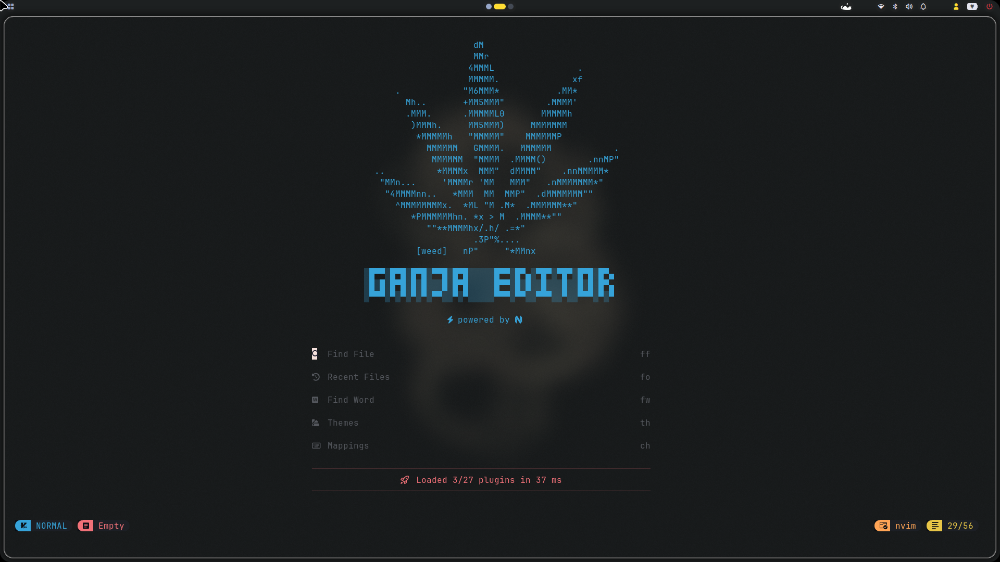
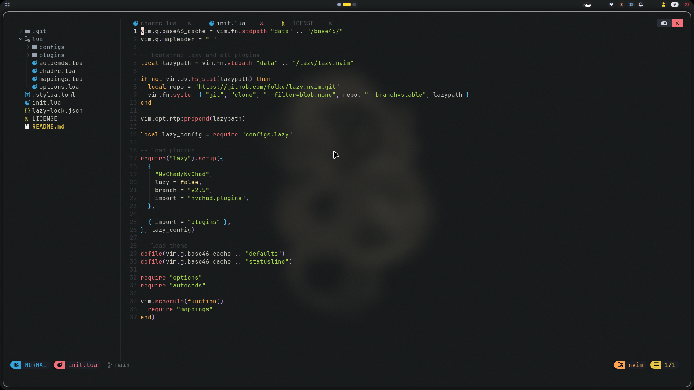
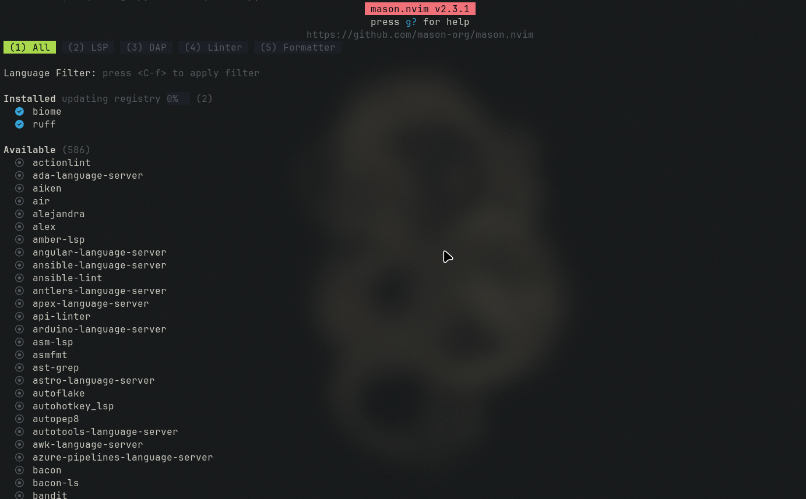
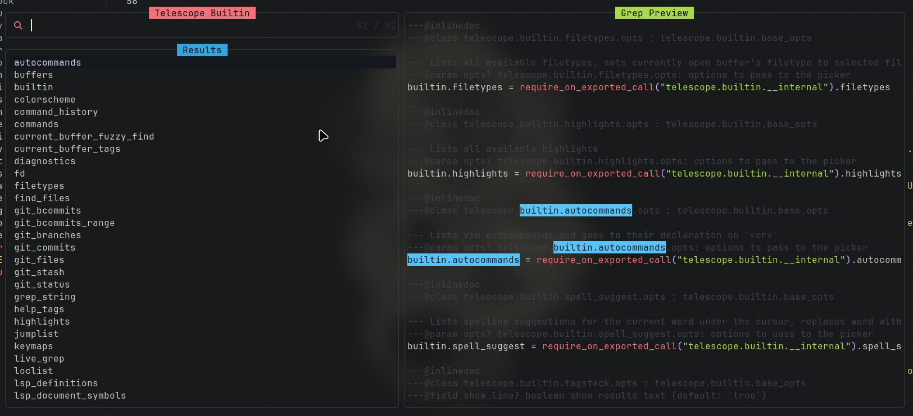
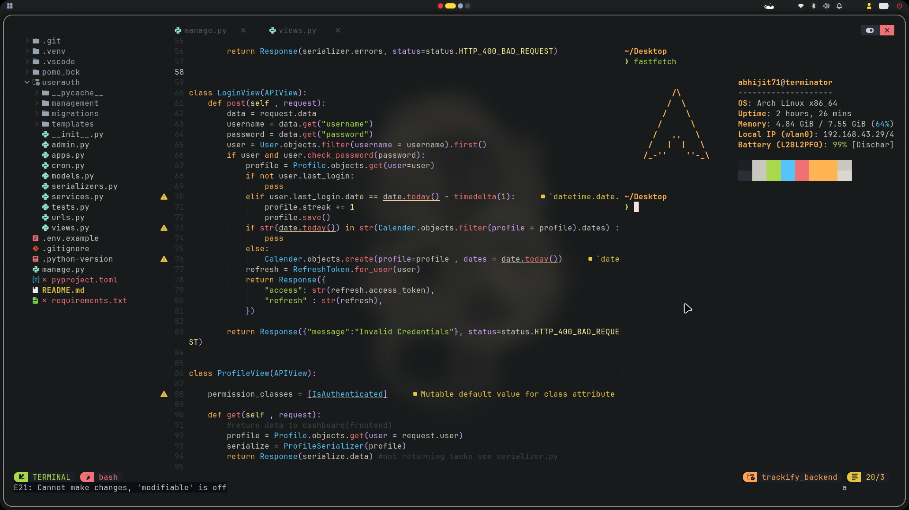

# GANJA EDITOR

A fast, minimal, and opinionated Neovim setup built on top of **NvChad**. WHich makes to addicted to prgramming like marijuana.

Why Neovim?

Because **VS Code sucks.** !!
No bloated Electron app, no endless extensions, no unnecessary UI — just a terminal, some Lua, and an editor that gets out of the way.

---

## Preview

### Dashboard

### Editor

### Mason

### Telescope

### Terminal

---

## Credits

Built with and inspired by:

* [Neovim](https://neovim.io/)
* [NvChad](https://github.com/NvChad/NvChad)
* [lazy.nvim](https://github.com/folke/lazy.nvim)
* [nvim-telescope](https://github.com/nvim-telescope/telescope.nvim)
* [nvim-treesitter](https://github.com/nvim-treesitter/nvim-treesitter)
* [Mason](https://github.com/mason-org/mason.nvim)

> Special thanks to the amazing Neovim community for making terminal-based development ridiculously good.

---

  <b>Neovim supremacy </b>

